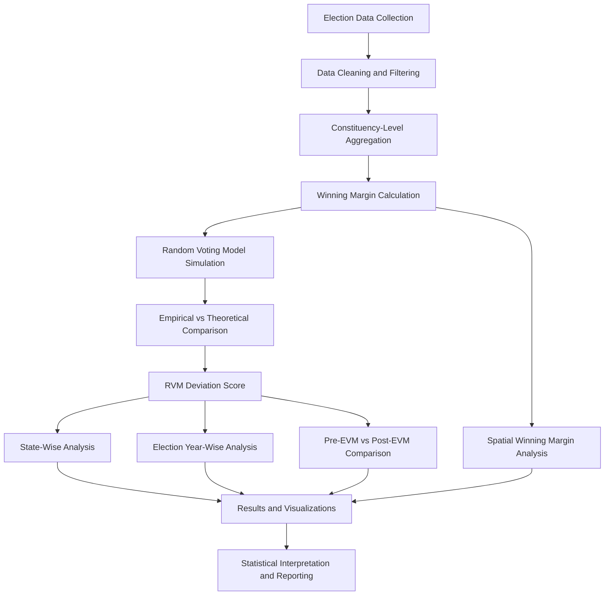

# Universal Statistical Patterns and Electoral Forensics of Indian General Elections

### Election Analysis Using the Random Voting Model (RVM)

A Python-based research project that analyzes Indian and global election data using the **Random Voting Model (RVM)** to study electoral competition, winning-margin distributions, and statistical anomalies.

The project compares actual election results with theoretical and simulated RVM predictions to investigate universal statistical patterns across countries, states, and election years.

## Project Overview

This project builds on an earlier analysis of elections across **29 countries** and extends the research to Indian Lok Sabha elections.

The analysis covers:

- **14 Indian states** and 8,539 constituency-election observations.
- State-wise RVM analysis from 1951 to 2019.
- Year-wise RVM analysis of 7 states through 2024.
- Pre-EVM vs Post-EVM comparison covering 10 general elections.
- Winning-margin contour maps for Uttar Pradesh, Bihar, and West Bengal.

## Project Workflow



## Key Features

### 1. State-Wise RVM Analysis

- Analyze electoral competition across 14 major Indian states.
- Calculate electoral winning margins and normalized margins.
- Compare empirical distributions with theoretical RVM predictions.
- Generate RVM plots, simulation bands, and deviation scores.

### 2. Election Year-Wise Analysis

Analyze changes in electoral competition from 1951 to 2024 for seven states:

- Bihar
- Gujarat
- Madhya Pradesh
- Rajasthan
- Tamil Nadu
- Uttar Pradesh
- West Bengal

Individual election-year plots help identify changes in electoral margin distributions over time.

### 3. Pre-EVM vs Post-EVM Analysis

Compare electoral patterns across five elections before nationwide EVM adoption and five elections afterward.

| Pre-EVM Elections | Post-EVM Elections |
|---|---|
| 1989 | 2004 |
| 1991 | 2009 |
| 1996 | 2014 |
| 1998 | 2019 |
| 1999 | 2024 |

The analysis focuses on:

- Changes in average winning margins.
- Differences in electoral competition.
- Comparison of empirical and simulated RVM distributions.
- State-wise and nationwide electoral patterns.

### 4. Spatial Electoral Analysis

Generate winning-margin contour maps for:

- Uttar Pradesh
- Bihar
- West Bengal

**Election years:** 2014, 2019, and 2024.

These maps visualize geographical differences in electoral competitiveness, highlighting regions with close contests and large winning margins.

### 5. Statistical Anomaly Detection

- Calculate RVM deviation scores.
- Identify distributions that differ from model expectations.
- Use a threshold of 3.0 to flag results for further investigation.
- Compare deviations across states and election years.

A statistical anomaly does not independently establish electoral fraud.

## Project Structure

```text
Election-Analysis/
│
├── src/
│   ├── rvm_analysis.py
│   ├── india_rvm_analysis.py
│   ├── anomaly.py
│   ├── clean_clea_data.py
│   ├── aggregate_to_constituency.py
│   └── convert_to_300dpi.py
│
├── data/
│   ├── raw/
│   └── processed/
│
├── docs/
│
├── outputs/
│   ├── rvm_outputs/
│   ├── rvm_outputs_india/
│   └── 300dpi/
│
├── requirements.txt
└── README.md
```

This structure represents the original repository layout. Additional analyses described in the report may use scripts not listed above.

## Methodology

### Step 1: Data Preparation

Raw election data is cleaned, filtered, and aggregated from candidate-level records into constituency-level observations.

### Step 2: Electoral Margin Calculation

The following measures are calculated:

**Raw Margin**

`M = W - R`

**Specific Margin**

`μ = M / T`

**Scaled Specific Margin**

`x = μ / mean(μ)`

Where:

- `W` = Winner's votes
- `R` = Runner-up's votes
- `T` = Total valid votes

### Step 3: Random Voting Model

The RVM simulates electoral outcomes using three candidates.

1. Generate three random candidate weights.
2. Normalize the weights into voting probabilities.
3. Simulate votes using a multinomial distribution.
4. Calculate the winner-runner-up margin.
5. Repeat simulations 25 times per constituency.

The analytical distribution is:

`P(μ) = (1 - μ)(5 + 7μ) / [(1 + μ)²(1 + 2μ)²]`

### Step 4: RVM Deviation Score

The project calculates a statistical deviation score:

`Score = mean(|F_empirical - F_RVM| / σ_RVM)`

Lower scores indicate closer agreement with the simulated RVM distribution.

### Step 5: Visualization

Generate state-wise RVM plots, year-wise comparisons, Pre-EVM/Post-EVM plots, electoral margin trends, and geographical contour maps.

## Key Results

| Metric | Result |
|---|---|
| States analyzed | 14 |
| Constituency-election observations | 8,539 |
| Baseline analysis period | 1951–2019 |
| Year-wise analysis | Through 2024 |
| Lowest RVM score | Uttar Pradesh: 0.701 |
| Highest RVM score | Bihar: 2.522 |
| Anomaly threshold | 3.0 |
| Highest average specific margin | Maharashtra: 0.179 |
| Lowest average specific margin | Kerala: 0.092 |
| Pre-EVM mean specific margin | 0.1223 |
| Post-EVM mean specific margin | 0.1325 |

### Major Findings

- All 14 states recorded RVM deviation scores below the selected threshold of 3.0.
- Indian electoral margin distributions broadly resemble the theoretical RVM predictions.
- Electoral competition varies between states and across election years.
- Pre-EVM and Post-EVM elections exhibit broadly similar distributional patterns.
- Spatial maps reveal geographical changes in electoral competitiveness.

## Technology Stack

| Category | Technologies |
|---|---|
| Programming Language | Python |
| Data Processing | Pandas, NumPy |
| Statistical Computing | SciPy |
| Data Visualization | Matplotlib, Seaborn |
| Geospatial Analysis | GeoPandas, Shapely |
| Data Formats | CSV, XLSX |
| Version Control | Git, GitHub |

## Installation and Usage

### 1. Clone the Repository

```bash
git clone <repository-url>
cd Election-Analysis
```

### 2. Install Dependencies

```bash
pip install -r requirements.txt
```

### 3. Run Global RVM Analysis

```bash
python src/rvm_analysis.py --data data/processed/constituency_level_results.csv
```

### 4. Run India RVM Analysis

```bash
python src/india_rvm_analysis.py
```

### 5. Export High-Resolution Figures

Use `src/convert_to_300dpi.py` to prepare high-quality plots for academic reports and presentations.

## Data Sources

- Election Commission of India (ECI)
- Constituency-Level Elections Archive (CLEA)
- Publicly available global election datasets

## Research Reference

Pal, S., Kumar, S., and Santhanam, M. S. (2024). *Universal Statistics of Competition in Democratic Elections.*

## Future Scope

- Extend baseline state-level RVM analysis to 2024.
- Perform booth-level electoral analysis.
- Expand spatial analysis to additional states.
- Investigate RVM models with more than three candidates.
- Develop an interactive election analytics dashboard.

## Author

**Ayush Singh**

BML Munjal University

## Disclaimer

This project is intended for academic research. Statistical deviations from the RVM are indicators for further investigation and do not independently prove electoral manipulation or election integrity.